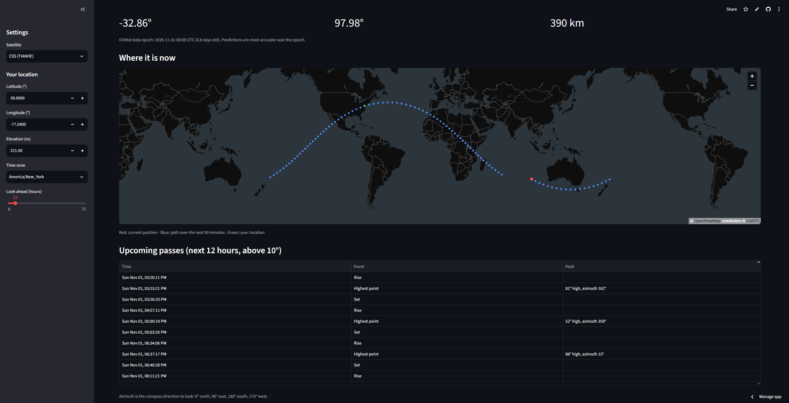

# 🛰️ Satellite Pass Predictor

A web app that tracks satellites in real time and predicts when they will pass over any location on Earth, using live orbital data.

**Live app:** [add your Streamlit link here]



## Features

- **Live position:** current latitude, longitude, and altitude of the ISS or other space stations
- **Ground track map:** the satellite's path over the next 90 minutes
- **Pass predictions:** rise, highest point, and set times for any location, in your time zone
- **Where to look:** peak altitude and compass direction (azimuth) for each pass

## How it works

1. **Orbital data:** downloads Two-Line Element sets (TLEs) for space stations from [CelesTrak](https://celestrak.org). The data is refreshed when it is more than a day old, balancing accuracy against load on CelesTrak's free service.
2. **Orbit propagation:** uses [Skyfield](https://rhodesmill.org/skyfield/) and the SGP4 model to compute each satellite's position at any time.
3. **Coordinate conversion:** converts positions from an Earth-centered frame to latitude, longitude, and altitude using the WGS84 Earth model.
4. **Pass prediction:** computes the observer-to-satellite vector to find when the satellite rises above a 10° elevation mask, reaches its peak, and sets.

## Tech stack

Python · Skyfield · Streamlit · pandas · NumPy

## Run it locally

```bash
git clone https://github.com/<your-username>/satellite-tracker.git
cd satellite-tracker
python -m venv .venv
.venv\Scripts\activate        # Windows (macOS/Linux: source .venv/bin/activate)
pip install -r requirements.txt
streamlit run app.py
```

To print passes over Clemson, SC in the terminal instead:

```bash
python tracker.py
```

## Project structure

| File | Purpose |
|---|---|
| `tracker.py` | Core logic: loading TLE data, finding satellites, positions, ground tracks, pass prediction |
| `app.py` | Streamlit web interface |
| `requirements.txt` | Python dependencies |
